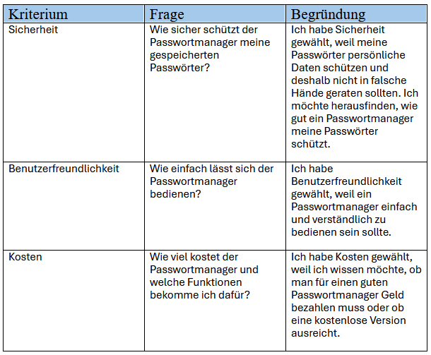
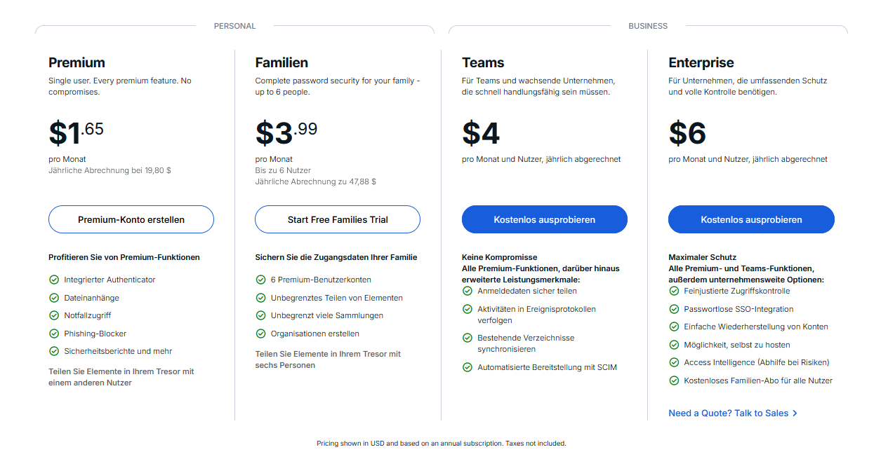
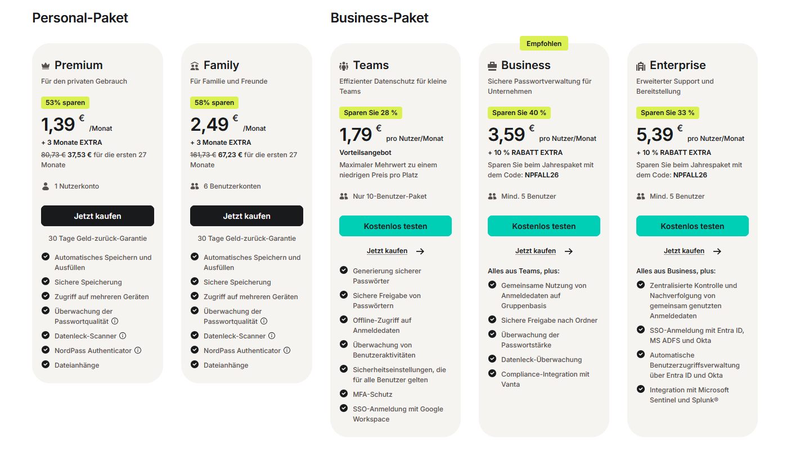
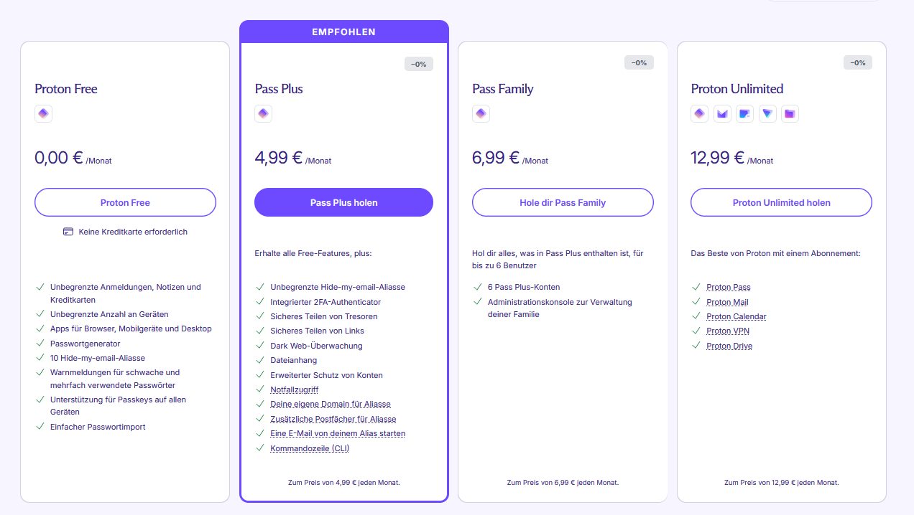
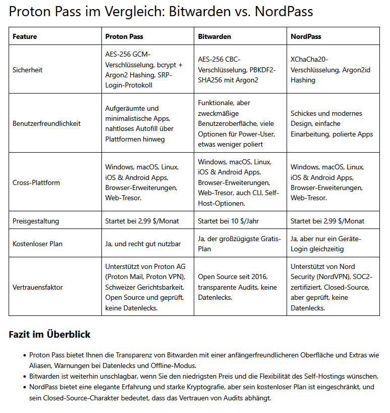
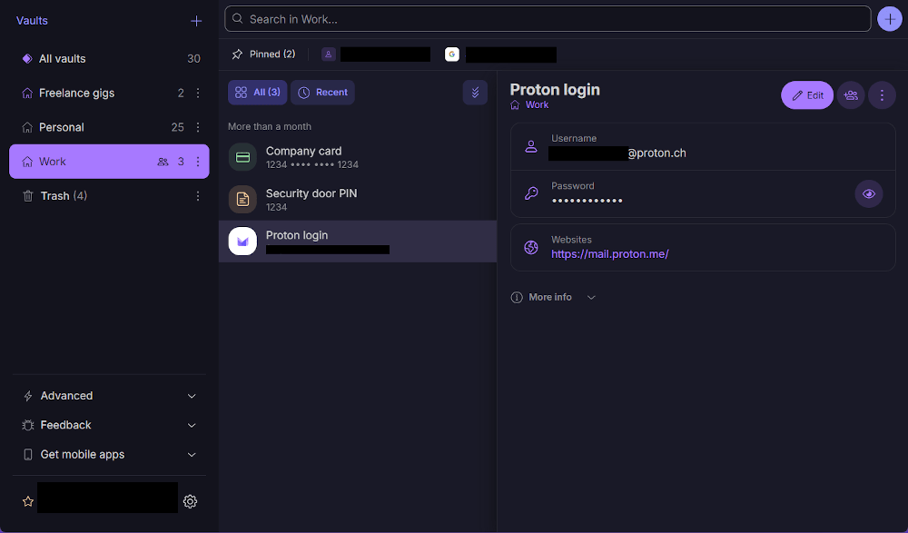
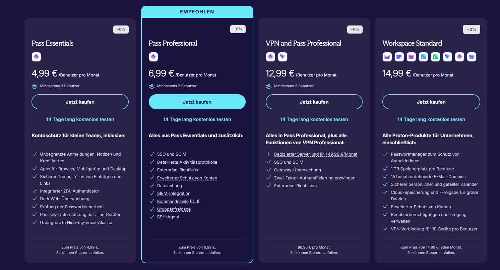

### Was ist ein Passwortmanager?
Ein Passwortmanager ist ein Cybersicherheitstool, das Passwörter speichert, automatisch ausfüllt und sichere Passwörter für dich generiert. Passwortmanager reduzieren die Anzahl der verschiedenen, komplexen Passwörter, die du dir in deinem digitalen Alltag merken musst, auf ein einziges – und zwar auf das Masterpasswort für deinen Passwortmanager. 
Quelle: https://nordvpn.com/de/password-manager/?nc=22797247436&ns=google&nm=cpc&nt=best%20vpn%20reddit&na=180867302765&gad_source=1&gad_campaignid=22797247436&gclid=EAIaIQobChMI7dSMm-bSlwMVYERBAh3njSxwEAAYAyAAEgJe7_D_BwE vom 24.10.2026; Titel: Passwort-Manager; Unternehmen / Anbieter: NordVPN
### Meine Leitfrage:
Macht ein Passwortmanager meine Passwörter sicherer, oder entstehen dadurch neue Risiken?

_Warum habe ich diese Leitfrage gewählt?_
Da ich dem Zuschauer oder Zuhörer eine wichtige Funktion eines Passwortmanagers darstellen und gleichzeitig die damit verbundenen Risiken erklären möchte. 
### Meine Kriterien:
1.**Sicherheit**  
**Frage:** _Wie sicher schützt der Passwortmanager meine gespeicherten Passwörter?_
2.**Benutzerfreundlichkeit**  
**Frage:** _Wie einfach lässt sich der Passwortmanager bedienen?_
3.**Kosten**  
**Frage:** _Wie viel kostet der Passwortmanager und welche Funktionen bekomme ich dafür?_

_Warum habe ich diese Kriterien gewählt?_
_1.Sicherheit:_
Ich habe Sicherheit gewählt, weil meine Passwörter persönliche Daten schützen und deshalb nicht in falsche Hände geraten sollten. Ich möchte herausfinden, wie gut ein Passwortmanager meine Passwörter schützt.
_2.Benutzerfreundlichkeit:_
Ich habe Benutzerfreundlichkeit gewählt, weil ein Passwortmanager einfach und verständlich zu bedienen sein sollte.
_3.Kosten:_
Ich habe Kosten gewählt, weil ich wissen möchte, ob man für einen guten Passwortmanager Geld bezahlen muss oder ob eine kostenlose Version ausreicht.

### Passwortmanager im Vergleich:
Als Beispiel für Passwortmanager-Dienste habe ich diese ausgewählt: 
1. NordPass Business
2. Bitwarden
3. Proton Pass

**NordPass:**
   - 11 Millionen Nutzer
   - über 11.500 Unternehmen
   -  nutzen die XChaCha20-Verschlüsselung
   - Kostenloses Paket für Privatpersonen
Quellen: 
- https://nordpass.com/de/password-manager/offer/ geöffnet am 25.10.2026; Titel: Passwort-Manager; Unternehmen / Anbieter: NordPass
- https://nordpass.com/de/features/xchacha20-encryption/ geöffnet am 25.10.2026; Titel: XChaCha20-Verschlüsselung; Unternehmen / Anbieter: NordPass
- https://nordpass.com/de/plans/ geöffnet am 25.10.2026; Titel: Kostenlose Version und Premium-Pakete; Unternehmen / Anbieter: NordPass
 **Bitwarden:**
   - 15 Millionen Benutzer
   - über 80.000 Unternehmen
   - Bitwarden verwendet AES-CBC 256-Bit-Verschlüsselung für die Tresor-Daten
   - Kostenloser Account für Privatpersonen
Quellen:
- https://finance.yahoo.com/technology/ai/articles/bitwarden-surpasses-15-million-users-160000253.html geöffnet am 25.10.2026; Titel: Bitwarden Surpasses 15 Million Users; Unternehmen / Anbieter: Yahoo Finance
- https://bitwarden.com/de-de/help/what-encryption-is-used/ geöffnet am 25.10.2026; Titel: Welche Verschlüsselung wird verwendet?; Unternehmen / Anbieter: Bitwarden
- https://bitwarden.com/de-de/about/ geöffnet am 25.10.2026; Titel: Über uns; Unternehmen / Anbieter: Bitwarden
- https://bitwarden.com/go/start-free/ geöffnet am 25.10.2026; Titel: Kostenlos starten; Unternehmen / Anbieter: Bitwarden
**Proton Pass:**
   - Über 100 Millionen Menschen und Unternehmen
   - 256-Bit-AES-GCM-Tresorverschlüsselung
   - Kostenloses Paket für Privatpersonen
Quellen:
- https://proton.me/de/pass geöffnet am 25.10.2026; Titel: Proton Pass: Kostenloser Passwortmanager mit Identitätsschutz; Unternehmen / Anbieter: Proton
- https://proton.me/de/pass/security geöffnet am 25.10.2026; Titel: Proton Pass: Sicherer und verschlüsselter Passwort-Manager; Unternehmen / Anbieter: Proton
- https://de.wikipedia.org/wiki/Proton_(Softwarehersteller) geöffnet am 25.10.2026; Titel: Proton (Softwarehersteller); Unternehmen / Anbieter: Wikipedia
- https://proton.me/de/pass/pricing geöffnet am 25.10.2026; Titel: Proton Pass: Preise und Abonnements; Unternehmen / Anbieter: Proton

**_Kosten und Funktionen:_** 
Die Kosten, die man jeweils für die drei verschiedenen Passwortmanager bezahlen muss, stehen auf den jeweiligen Webseiten.
Bitwarden: https://bitwarden.com/de-de/pricing-all/ geöffnet am: 07.10.2026; Titel: Preise; Unternehmen / Anbieter: Bitwarden
NordPass: https://nordpass.com/de/pricing/ geöffnet am: 07.10.2026; Titel: Preise; Unternehmen / Anbieter: NordPass
ProtonPass: https://proton.me/de/pass/pricing geöffnet am: 07.10.2026; Titel: Proton Pass: Preise und Abonnements; Unternehmen / Anbieter: Proton

Bitwarden:

NordPass:

ProtonPass:

 **_Vergleich:_**
 Auf der Seite „adblock-tester.com“ (https://adblock-tester.com/ad-blockers/de/proton-pass-de/ von dem 07.10.2026; Titel: Proton Pass; Unternehmen / Anbieter: AdBlock Tester) habe ich
 eine Tabelle gefunden, die ebenfalls viele Eigenschaften der drei Passwortmanager darstellt und vergleicht.
 

## Proton Pass:
Entwickler: Schweizer Unternehmen Proton AG (Hauptsitz: Plan-les-Quates bei Genf, Schweiz)
Markteinführung: Sommer 2023
Sicherheitsarchitektur: Ende-zu-Ende-Verschlüsselung (E2EE)
Plattformen: Windows, macOS, Linux, iOS, Android und Browser-Erweiterungen für Firefox, Chrome, Brave und Edge
Diese Informationen habe ich von diesen Webseiten:
- https://de.wikipedia.org/wiki/Proton_(Softwarehersteller)  geöffnet am: 22.10.2026; Titel: Proton (Softwarehersteller); Unternehmen / Anbieter: Wikipedia
- https://de.wikipedia.org/wiki/Proton_(Softwarehersteller)#Proton_Pass  geöffnet am: 22.10.2026; Titel: Proton (Softwarehersteller); Unternehmen / Anbieter: Wikipedia
- https://proton.me/de/blog/proton-pass-security-model  geöffnet am: 22.10.2026; Titel: Das Sicherheitsmodell von Proton Pass; Unternehmen / Anbieter: Proton
- https://proton.me/de/pass/download  geöffnet am: 22.10.2026; Titel: Proton Pass herunterladen; Unternehmen / Anbieter: Proton

### Sicherheit von Proton Pass: 
- Ende-zu-Ende-Verschlüsselung (E2EE)
- Zero-Knowledge-Prinzip
- Server liegen ausschließlich in:
1. der Schweiz
2. Deutschland
3. Norwegen
- man kann sich E-Mail-Aliase erstellen
- Tresorverschlüsselung
- Elementverschlüsselung

Was ist Ende-zu-Ende-Verschlüsselung (E2EE)?
Ende-zu-Ende-Verschlüsselung (E2EE) verschlüsselt deine Daten auf deinem Gerät und entschlüsselt sie erst auf dem Gerät des Empfängers. Bei „Ende-zu-Ende“ ist ein Ende der Ursprung (dein Gerät) und das andere das Ziel (das Gerät des Empfängers) der Reise deiner Daten.

Was ist das Zero-Knowledge-Prinzip?
Zero-Knowledge bedeutet, dass der Cloud-Dienstleister keine Kenntnis über die in der Cloud gespeicherten Daten und Informationen erlangt, wodurch absolute Vertraulichkeit gewährleistet wird.

Was sind Aliase?
Diese Funktion ermöglicht es dir, zufällig generierte E-Mail-Adressen zu erstellen, die du anstelle deiner echten E-Mail-Adressen für Online-Konten verwenden kannst. So kannst du einfach einen Alias abschalten, der mit einem Dienst verknüpft ist, der gehackt wurde oder anfängt, dir Spam zu senden, ohne deine anderen Konten zu beeinträchtigen.

Wie funktioniert die Tresorverschlüsselung?
Proton Pass schützt seine Tresore durch mehrere Verschlüsselungsebenen. Der Benutzerschlüssel wird mithilfe von bcrypt und einem individuellen Salt geschützt. Für jeden Tresor wird ein zufälliger, 32 Byte großer Tresorschlüssel erstellt, der mit dem Benutzerschlüssel verschlüsselt und signiert wird. Dadurch soll nur berechtigten Nutzern der Zugriff ermöglicht werden. Geteilte Tresore werden zusätzlich mit den öffentlichen Schlüsseln der jeweiligen Nutzer geschützt. Die einzelnen Einträge werden anschließend mit AES-GCM und 256-Bit-Verschlüsselung verschlüsselt.

Was bedeutet Elementverschlüsselung?

Bei der Elementverschlüsselung wird jeder gespeicherte Eintrag, zum Beispiel ein Passwort, eine Notiz oder ein Benutzername, einzeln verschlüsselt. Dafür bekommt jeder Eintrag einen eigenen zufälligen Schlüssel. Dieser Schlüssel wird wiederum mit dem Schlüssel des Tresors verschlüsselt.

Der Vorteil: Man kann einzelne Einträge sicher mit anderen teilen, ohne den gesamten Tresor freigeben zu müssen. Dadurch erhalten andere nur Zugriff auf die Daten, die tatsächlich mit ihnen geteilt wurden.

Informationen von diesen Webseiten:
- https://proton.me/de/pass/privacy-policy?utm_source=chatgp geöffnet am: 22.10.2026; Titel: Datenschutzrichtlinie; Unternehmen / Anbieter: Proton
- https://teamdrive.com/blog-de/zero-knowledge/ geöffnet am: 22.10.2026; Titel: Zero-Knowledge; Unternehmen / Anbieter: TeamDrive
- https://proton.me/de/learn/encryption/types-of-encryption/what-is-end-to-end geöffnet am: 22.10.2026; Titel: Was ist Ende-zu-Ende-Verschlüsselung?; Unternehmen / Anbieter: Proton
- https://proton.me/de/blog/proton-pass-security-model geöffnet am: 24.10.2026; Titel: Das Sicherheitsmodell von Proton Pass; Unternehmen / Anbieter: Proton 

### Benutzerfreundlichkeit von Proton Pass:

Die Proton Pass Desktop-App ist in drei Bereiche unterteilt.

Auf der linken Seite können Sie auf Ihre verschiedenen Tresore zugreifen – die Verzeichnisse für Ihre verschiedenen **Einträge** (Mit „Einträgen“ sind beispielsweise Anmeldungen, Kreditkarten und Notizen gemeint.) – sowie auf Ihren **Papierkorb** und verschiedene weitere Optionen.

Tresore können verwendet werden, um Einträge zu organisieren – im obigen Beispiel haben wir einen Tresor für persönliche Einträge und einen für berufliche Einträge.

Im mittleren Bereich findest du eine Liste aller Einträge im ausgewählten Tresor.

Der Bereich auf der rechten Seite zeigt Ihnen Details zu einem ausgewählten Eintrag.

Quelle (auch von dem Bild): https://proton.me/de/support/how-to-use-proton-pass-desktop-app geöffnet am 25.10.2026; Titel: So verwendest du die Proton-Pass-Desktop-App; Unternehmen / Anbieter: Proton

### Kosten von Proton Pass (im Monat):
_Privates Konto:_ 

Unternehmen:

Ich werde für den Vergleich nur den Preis für Privatpersonen verwenden.

Quelle (von dem Bild): 
1. Bild: https://proton.me/de/pass/pricing vom 07.10.2026; Titel: Proton Pass: Preise und Abonnements; Unternehmen / Anbieter: Proton
2. Bild: https://proton.me/de/business/pass/pricing geöffnet am 25.10.2026; Titel: Proton Pass für Unternehmen – Preise; Unternehmen / Anbieter: Proton

### Verschlüsselungen:
Was ist die XChaCha20-Verschlüsselung?
Der XChaCha20-Algorithmus ist eine Methode zum Ver- und Entschlüsseln von Daten. Er unterstützt Schlüssel in zwei verschiedenen Längen, wobei die 256-Bit-Verschlüsselung am sichersten ist. NordPass verwendet XChaCha20 zum Verschlüsseln Ihres Passwort-Tresors.

Darum setzt NordPass auf XChaCha20?
Die meisten Passwort-Manager und Sicherheitsprodukte wurden für die AES-256-Verschlüsselung konzipiert, die als anerkannter Sicherheitsstandard gilt. Warum setzt NordPass also auf eine andere Lösung?
Wir möchten, dass unser Produkt möglichst langlebig und die Sicherheit unserer Kunden auf lange Sicht gewährleistet ist. Die AES-Verschlüsselung ist zwar schnell und sicher, zeigt jedoch einige frühe Anzeichen dafür, dass sie in Zukunft möglicherweise geknackt werden könnte. In diesem Fall müssen die meisten Produkte dann auf ältere Verschlüsselungsalgorithmen zurückgreifen. Das möchten wir vermeiden, denn wir wollen uns nach vorne und nicht zurückbewegen. In technischer Hinsicht haben wir uns aus folgenden Gründen für XChaCha20 entschieden:
- Es ist schneller zu implementieren als AES-256. Auf Plattformen ohne AES-Hardware ist es rund dreimal schneller.
- Es ist einfacher, wodurch technische und menschliche Fehler bei der Implementierung leichter zu vermeiden sind.
- Es erfordert keine Hardware-Unterstützung.
- Mobile Plattformen stellen langsam aber sicher auf XChaCha20 um, sodass es in naher Zukunft noch weiter verbreitet sein wird.

Was ist die AES-Verschlüsselung?
Die AES-Verschlüsselung ist ein weit verbreiteter Algorithmus oder eine sogenannte Blockchiffre, um Wifi-, Browser-Verbindungen und Daten zu verschlüsseln.

Das Wichtigste in Kürze:
- **Definition:** AES (Advanced Encryption Standard) ist ein symmetrisches Verschlüsselungsverfahren, bei dem derselbe Schlüssel für die Ver- und Entschlüsselung verwendet wird.
- **Schlüssellängen:** AES unterstützt Schlüsselgrößen von 128, 192 und 256 Bit, was in den Bezeichnungen AES-128, AES-192 und AES-256 zum Ausdruck kommt.
- **Anwendungsbereiche:** AES wird weltweit eingesetzt, um sensible Daten zu schützen, einschließlich der Verschlüsselung von Daten auf Servern, in drahtlosen Netzwerken (z. B. WPA2 und WPA3) und bei sicheren Browser-Verbindungen (TLS-Protokoll).
- **Funktionsweise:** Der Algorithmus arbeitet mit einem Substitutions-Permutations-Netzwerk, das Daten in mehreren Runden durch Substitution und Permutation in scheinbar zufällige Zeichenfolgen umwandelt, um sie zu verschlüsseln.

Was ist AES 256?
Advanced Encryption Standard (AES) 256 ist ein praktisch undurchdringlicher symmetrischer Verschlüsselungsalgorithmus, der einen 256-Bit-Schlüssel verwendet, um Ihren Klartext oder Ihre Daten in eine Chiffre umzuwandeln.

Quellen:
- https://nordpass.com/de/features/xchacha20-encryption/ geöffnet am 26.10.2026; Titel: Was ist die XChaCha20-Verschlüsselung?; Unternehmen / Anbieter: NordPass
- https://www.skribble.com/de-de/blog/aes-verschlusselung/ geöffnet am 26.10.2026; Titel: Was ist die AES-Verschlüsselung?; Unternehmen / Anbieter: Skribble
- https://www.progress.com/de/blogs/aes-256-verschluesselung-fuer-sichere-daten-verwenden geöffnet am 26.10.2026; Titel: AES-256-Verschlüsselung für sichere Daten verwenden; Unternehmen / Anbieter: Progress